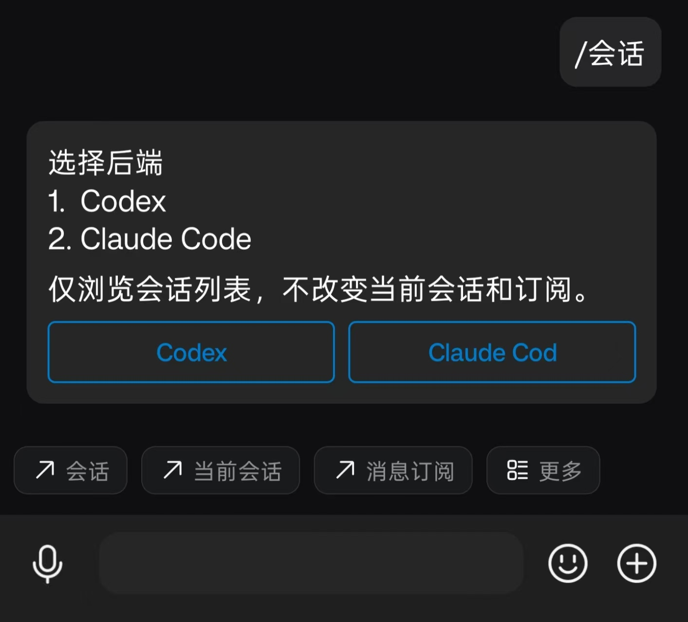
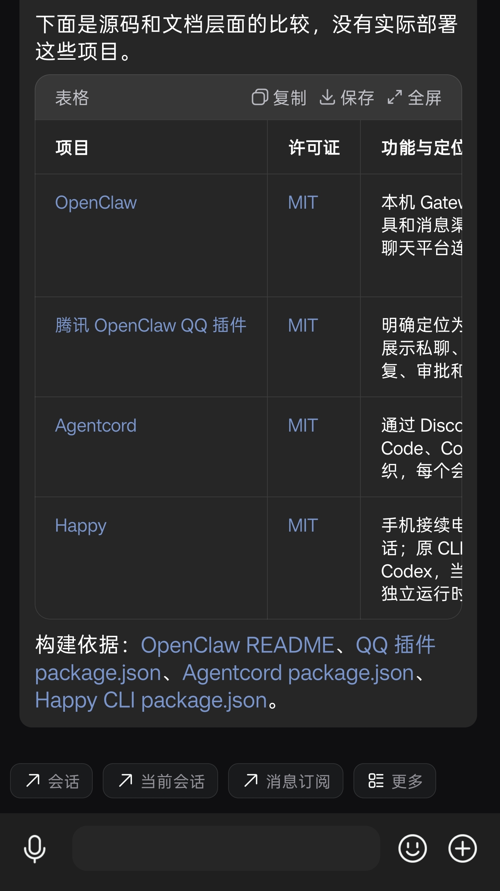

# QQ Agent Bot · QQ 编程助手

[](https://github.com/wllevy/qq-agent-bot/actions/workflows/check.yml)
[](LICENSE)


**在 QQ 私聊中继续电脑上的 Codex / Claude Code 任务，完成后接收回复和文件。**

## 设计思路

复用 QQ 官方机器人提供的客户端交互能力，把会话、当前任务、消息订阅等入口放进底部菜单，再通过一、二级菜单和消息按钮展开操作。浏览会话、查看进度、调整设置都可以点选，减少记忆和输入命令的负担。

QQ 私聊中的所有消息都在同一个聊天窗口里，没有 Discord 式的子线程来分别承载任务。因此，这里的交互采用**邮件式的思路**：选中一个 session，发送指令，自动订阅本轮回复；任务在电脑上执行，完成后把结果送回 QQ。发送后可以切换到其他 session，之前的任务和待收回复都会保留。

需要持续跟进时，开启**长期订阅**，该会话后续可读取的模型回复也会推送到 QQ，包括在电脑端交互产生的结果。QQ 提供远程操作和提醒入口，桌面端仍可照常使用。

<p align="center">
  
</p>

## 能做什么

浏览、搜索和新建会话，发送任务，查看进度与历史，管理队列，停止执行，收发文件，以及订阅完成通知。

| 能力 | Codex | Claude Code |
| --- | --- | --- |
| 继续会话 | 支持本机桌面会话 | Bot 管理会话直接续聊；其他历史恢复为独立副本 |
| 执行方式 | 桌面 IPC / 本机 app-server | 官方 Agent SDK，独立于桌面 App 运行 |
| 权限确认 | 在 Codex 桌面处理 | 在 QQ 批准、拒绝或回答；可配置 YOLO |
| 回复订阅 | 本轮自动订阅、长期订阅 | 同左；原历史与恢复副本分别订阅 |

**Markdown 渲染**：模型回复中的表格、链接等内容可以直接在 QQ 客户端中渲染。表格支持复制、保存和全屏查看，方便在手机上阅读结果。

<p align="center">
  
</p>

目前支持 **Windows + QQ 官方机器人私聊**。电脑需要保持开机联网，至少启用一个后端。[完整能力与使用说明 →](docs/usage.md)

## 快速开始

在 [QQ 开放平台](https://q.qq.com/) 准备支持私聊的机器人及 AppID / AppSecret。Codex 使用已登录的桌面应用；Claude 需要单独完成 SDK 登录。

在 PowerShell 中运行：

```powershell
irm https://github.com/wllevy/qq-agent-bot/releases/latest/download/install.ps1 | iex
```

安装器自动准备 Node.js 和程序，无需预装 Git 或管理员权限。按向导配置后端，并用自己的 QQ 发送配对码、在电脑上确认授权。也可先[查看安装脚本](scripts/install.ps1)。

Claude 登录未完成时，在新终端运行 `qq-agent-bot claude-login`，完成授权后用 `qq-agent-bot setup` 继续配置。

如果没有在向导中启用后台启动：

```powershell
qq-agent-bot service start
```

运行一次 `qq-agent-bot menus` 设置底部菜单和指令面板，然后在 QQ 中发送 **会话**：

```text
选择 session → 发送任务 → 自动订阅本轮 → 完成后收到回复
长期订阅     → 持续接收该会话后续结果
订阅         → 查看并取消订阅
```

遇到连接问题，运行 `qq-agent-bot doctor`。已有部署请先阅读[迁移步骤](docs/usage.md#从源码部署迁移)。

### 让 Agent 帮你安装

将下面这段话发给编程 Agent：

> 请阅读 https://github.com/wllevy/qq-agent-bot/blob/main/docs/agent-install.md ，按其中流程安装并配置 QQ Agent Bot。需要登录或确认 QQ 身份时让我完成，不要在聊天里索取 AppSecret。

## 文档

- [使用指南](docs/usage.md)：后端能力、登录与配对、QQ 命令、订阅规则、更新和迁移。
- [Agent 安装指南](docs/agent-install.md)：非交互配置、JSON 诊断和分阶段配对。
- [开发指南](docs/development.md)：源码运行、测试、导出与发布。
- [权限与凭据](SECURITY.md)：访问控制和凭据保存。

[MIT License](LICENSE)。第三方依赖遵循各自许可证及服务条款。

